### [▶ Launch the live particle engine](https://rfarris-dch.github.io/rfarris-dch/)

Scroll it. Push the pointer through it. Click for a shockwave.

---

GitHub strips every script from a README, so the banner above is a hand-written animated SVG with no JavaScript. The real show lives in [`index.html`](./index.html), one self-contained file served by GitHub Pages.

## What it does

160,000 points of light morph through six forms as you scroll: this username, a spiral galaxy, the Lorenz attractor, a sixty-rack data hall, a planet with rings, and a torus knot. Nothing is downloaded except three.js itself. There are no models, textures, or images.

| Chapter | Technique |
| --- | --- |
| Name | Glyphs rasterized to an offscreen canvas, then sampled into points |
| Galaxy | Morph, stagger and turbulence computed entirely in the vertex shader |
| Lorenz attractor | `σ=10 ρ=28 β=8/3` integrated 160,000 steps at load |
| Data hall | Procedural cabinets, status lights and floor grid from arithmetic |
| Planet | Rejection sampling against a noise field for continents |
| Torus knot | 16-bit HDR bloom, chromatic aberration, film grain, ACES tone mapping |

## Under the hood

- **One draw call** for every particle, with additive blending
- **Divergence-free flow field** in GLSL throws particles around mid-morph
- **Pointer ray casting** opens a hole in the cloud; a click fires a spherical shockwave
- **Fullscreen fractal nebula** drawn on a single triangle
- **Adaptive quality** sheds resolution, then particles, if a device drops below 28 fps
- **Respects** `prefers-reduced-motion`

Built with three.js r170 and about 600 lines of hand-written code.

