<picture>
  <source media="(prefers-color-scheme: dark)" srcset="./assets/banner-dark.svg" />
  <source media="(prefers-color-scheme: light)" srcset="./assets/banner-light.svg" />
  
</picture>

  

  <picture>
    <source media="(prefers-color-scheme: dark)" srcset="./assets/toolbox-dark.svg" />
    <source media="(prefers-color-scheme: light)" srcset="./assets/toolbox-light.svg" />
    
  </picture>

  
   
  

<picture>
  <source media="(prefers-color-scheme: dark)" srcset="./assets/lamp-dark.svg" />
  <source media="(prefers-color-scheme: light)" srcset="./assets/lamp-light.svg" />
  
</picture>
